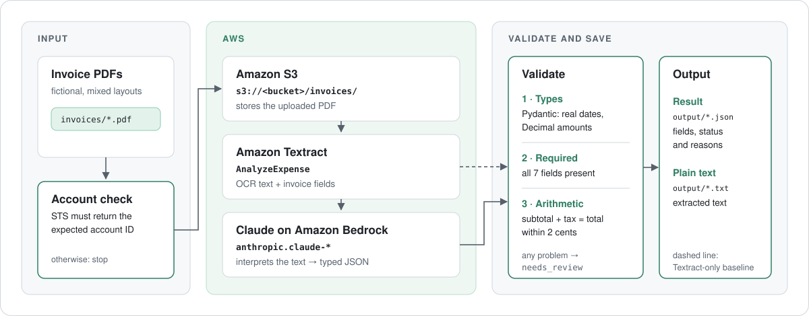

# AWS Document Processing

Extracting and validating supplier invoice data with Amazon S3, Amazon Textract and Claude on Amazon Bedrock. All invoices are fictional.



## Setup

```bash
python3.12 -m venv .venv
source .venv/bin/activate
pip install -r requirements.txt
cp .env.example .env
```

AWS setup is done by hand in the Console: see [docs/aws-setup.md](docs/aws-setup.md).

## Sample invoices

```bash
python make_invoices.py
```

Writes 8 fictional one-page invoices to `invoices/`, plus `invoices/expected.json`: the values
actually printed on each, and the status a perfect extraction should get.

Each supplier has its own colour, font, logo and one of five layouts (classic, banner, sidebar,
letterhead, receipt). Most also print an ABN and a due date: realistic distractors that sit next to
the invoice number and invoice date.

| File | Layout | Scenario | Expected |
|---|---|---|---|
| 01-northwind-office | classic | Complete and correct | accepted |
| 02-bluegum-consulting | banner | Date written out in words | accepted |
| 03-harbour-print | letterhead | Invoice number missing | needs_review |
| 04-kestrel-it | sidebar | Total is $10.00 more than subtotal + tax | needs_review |
| 05-coastal-catering | sidebar | Total 1 cent off from rounding (within tolerance) | accepted |
| 06-summit-freight | banner | Currency not stated, only `$` | needs_review |
| 07-tui-timber | classic | NZ supplier: NZD, 15% GST, ISO date | accepted |
| 08-corner-cafe | receipt | GST-inclusive prices, no subtotal printed | needs_review |

## Tests

```bash
pytest
```

The tests don't call AWS.
